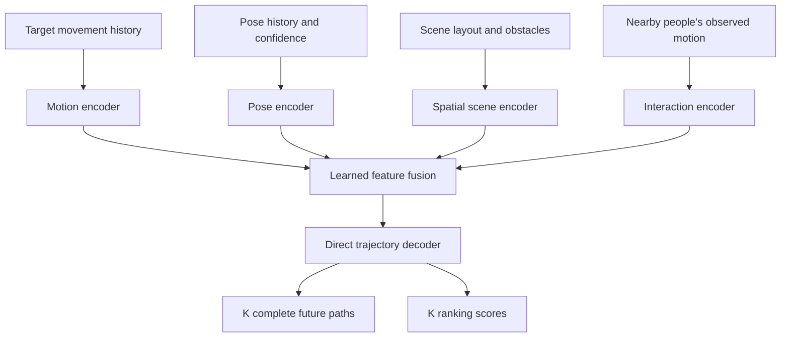

# Pedestrian Trajectory Prediction

**Bachelor's thesis · Computer vision and deep learning · Phase 1: design**

Predict several plausible future paths for a pedestrian from their recent movement, body pose, surrounding scene, and nearby people. The main work is to design, implement, and train a custom forecasting model, then evaluate it against simple baselines and an established predictor.

**Status:** Design candidate agreed. Dataset selection, implementation, training, and experimental results are pending.

## The idea

A person approaching an obstacle might pass on either side, slow down, or change direction. A useful predictor should represent several possible futures rather than average them into a single implausible route.

Our model will directly output **K complete trajectories**, each containing a sequence of future 2D positions and a learned ranking score. Each trajectory's endpoint is its final position; a separate destination predictor is not required. Scores will not be presented as calibrated probabilities without validation.

## Proposed design

The starting candidate uses a GRU for motion, a temporal pose encoder, a CNN retaining spatial scene features, and attention over neighboring pedestrians. A decoder predicts all future positions in one forward pass. These are design proposals to validate during Phase 1; exact layers, dimensions, and training losses remain open.

In the eventual video application, person detection, pose estimation, and an existing tracker will provide the observations. The custom forecasting network is the main thesis contribution.

## What we will build and reuse

| Part | Planned work |
| --- | --- |
| Detection and pose | Integrate pretrained models; investigate pedestrian detector fine-tuning when suitable training labels exist. |
| Tracking | Integrate an existing tracker to produce IDs and observation histories. |
| Custom predictor | Implement and train the encoders, fusion, trajectory outputs, and ranking objective. |
| Data and evaluation | Build aligned training windows, reproducible experiments, metrics, and component comparisons. |
| Established reference | Integrate Y-Net separately, subject to data and reproducibility checks. |
| Demonstration | Overlay observed trails, predicted alternatives, and the subsequently observed future on held-out video. |

## Research question

How much do pose, scene geometry, and neighboring pedestrians improve direct prediction of complete future paths over motion history alone, and what accuracy and runtime trade-offs does our design achieve relative to an established predictor?

We will measure displacement error, candidate coverage, scene consistency, and runtime. Controlled component removals will show which inputs help. Forecasting quality on annotated histories and performance with detector/tracker outputs will be reported separately.

This project proposes an implementation and an experimentally tested design. Combining these cues is not, by itself, a claim of scientific novelty.

## Start here

Read [PROJECT_PLAN.md](PROJECT_PLAN.md) for the scope, candidate architecture, open decisions, and Phase 1 completion criteria.

The immediate task is to inspect a small dataset sample and verify that it supports trajectories, usable pose, scene alignment, and neighboring pedestrians. A video alone is insufficient for supervised forecasting evaluation.

Setup commands and results will be added after they have been verified.

## References

- [Y-Net and PECNet: official implementations and paper links](https://github.com/HarshayuGirase/Human-Path-Prediction)
- [Human Scene Transformer: pose-informed trajectory forecasting](https://human-scene-transformer.github.io/)
- [Ultralytics pose estimation](https://docs.ultralytics.com/tasks/pose/)
- [Ultralytics tracking](https://docs.ultralytics.com/modes/track/)
